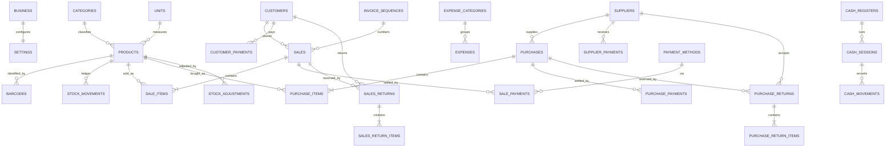

# Architecture — MERQO Retvia

**Product:** Retvia · **Brand:** MERQO · **Founder:** Shohan Khan · merqoonline@gmail.com
**Category:** Fully offline Windows desktop POS, Inventory & Business Management ERP
**Market:** Bangladesh (retail, grocery, superstore, departmental, wholesale)

---

## 1. Technology stack and justification

| Layer | Choice | Justification |
|---|---|---|
| Language | **Python 3.12** | Mature, stable, excellent Unicode handling, first-class `sqlite3` in the standard library, no runtime install needed by the customer after PyInstaller bundling. |
| Desktop UI | **PySide6 / Qt 6 Widgets** | Native desktop widgets, correct **Bengali complex-script shaping** (conjuncts, reph, hasanta) via Qt's text engine, mature `QPrinter` stack for exact-millimetre thermal paper, high-DPI support, deterministic layout. Official LGPL build — commercial redistribution permitted under LGPL v3 with dynamic linking (see THIRD_PARTY_NOTICES.md). |
| Database | **SQLite 3** (stdlib `sqlite3`) | Single engine, zero-admin, embedded, ACID, WAL journalling, foreign keys, proven at multi-GB scale. No database server for the customer to install. |
| Money | **Integer minor units (poisha)** | Eliminates binary floating-point error entirely. 1 BDT = 100 poisha. |
| Quantity | **Integer milli-units (×1000)** | Exact decimal quantities for kg/litre/gram without float drift. |
| Cryptography | **`cryptography` (Ed25519)** | Audited library, fast, small signatures, offline verification. |
| Excel export | **openpyxl** | Real `.xlsx` with number/date/currency formats and Unicode. |
| PDF export | **Qt `QPrinter` → PDF** | Uses the same shaped-text pipeline as printing, so Bengali renders identically in PDF and on paper. Fonts are embedded by Qt. |
| Packaging | **PyInstaller** (one-folder, self-contained) | Bundles CPython + Qt + SQLite; customer installs nothing else. |
| Installer | **Inno Setup 6** | Industry-standard Windows installer, per-user/per-machine, shortcuts, uninstaller that preserves user data. |
| Tests | **pytest** | Headless-testable business core; Qt GUI smoke tests run on Windows CI. |
| CI/CD | **GitHub Actions** (`windows-latest`) | Real Windows build, real installer, silent-install smoke test. |

### Why not Electron / Tauri / .NET?

- **Electron**: requires downloading Electron and NSIS binaries from GitHub release
  asset hosts, and native SQLite modules need Node headers. Both are unreachable from
  the build sandbox, so the product could not be built or verified end-to-end here.
  Electron also ships a ~150 MB Chromium runtime for a form-and-table business app.
- **Tauri**: needs the Rust toolchain and platform WebView2 SDK from non-allowlisted
  hosts; cross-compiling a Windows bundle from Linux is fragile.
- **.NET/WPF**: WPF cannot run or be tested on the Linux build sandbox at all, and
  the .NET SDK download host is unreachable.
- **Python + Qt** is installable entirely from the allowlisted package index, its
  business core is fully testable headlessly, and Qt gives the best Bengali
  typographic fidelity — the single hardest requirement in this product.

> **Environment constraint (documented, not hidden):** the development sandbox blocks
> `nodejs.org`, GitHub release-asset hosts, and Debian apt repos, and has no `libGL`
> or display server. Therefore **GUI rendering cannot be exercised locally**. All
> business logic, database, financial, licensing, backup and export layers are tested
> locally and headlessly; GUI rendering, Windows packaging, installer and end-to-end
> verification run on GitHub Actions Windows runners, which capture screen images as
> evidence.

---

## 2. Layered architecture

```
┌───────────────────────────────────────────────────────────┐
│ Presentation (retvia/ui)  — Qt widgets, views, dialogs    │
│   • no financial arithmetic, no SQL                       │
├───────────────────────────────────────────────────────────┤
│ Design system (retvia/ui/theme.py) — tokens, QSS          │
├───────────────────────────────────────────────────────────┤
│ Application services (retvia/services)                    │
│   products · inventory · sales · purchases · returns      │
│   parties · payments · expenses · cash_register           │
│   finance · reports · numbering · audit · settings        │
│   backup · licensing · importing · exporting              │
├───────────────────────────────────────────────────────────┤
│ Domain core (retvia/core)                                 │
│   money · quantity · rounding · validation · errors       │
├───────────────────────────────────────────────────────────┤
│ Data access (retvia/data)                                 │
│   connection · transactions · migrations · repositories   │
├───────────────────────────────────────────────────────────┤
│ SQLite (WAL, FK ON) — single file in user-data directory  │
└───────────────────────────────────────────────────────────┘
```

**Rule:** the UI never computes money and never issues SQL. Every mutation goes
through a service that owns validation, transaction boundaries and audit logging.

---

## 3. Data directory layout (Windows)

```
%LOCALAPPDATA%\Retvia\
    data\retvia.db            # live database (WAL mode)
    data\retvia.db-wal
    backups\                  # manual + automatic + pre-restore backups
    assets\business\          # uploaded business logo
    licenses\activation.json  # signed activation record
    logs\retvia.log           # rotating, sanitized
    config.json               # non-secret local config
```

Program files live in `%LOCALAPPDATA%\Programs\Retvia` (per-user) or
`C:\Program Files\Retvia` (per-machine). **The uninstaller never touches the
user-data directory**, so business data survives uninstall/reinstall.

---

## 4. Database design

Full DDL lives in `retvia/data/migrations/`. Core entity relationships:



### Integrity rules

- `PRAGMA foreign_keys = ON`, `journal_mode = WAL`, `synchronous = FULL`.
- Every financial/stock mutation runs inside **one** `BEGIN IMMEDIATE` transaction.
- Stock is never updated without a matching `stock_movements` row carrying
  `qty_before`, `qty_after`, `unit_cost`, `reference_type`, `reference_id`.
- Invoice numbers come from `invoice_sequences` updated atomically inside the same
  transaction — uniqueness is enforced by a UNIQUE index, not by application hope.
- Historical rows are never silently overwritten. Cancellation/edits create
  reversal entries (`reversal_of_id`) and keep the original.
- Money columns are `INTEGER` poisha; quantity columns are `INTEGER` milli-units.
- Migration history is recorded in `schema_migrations`; migrations are forward-only
  and each runs in a transaction.

---

## 5. Financial policy (summary — full text in docs/FINANCIAL_POLICY.md)

- **Costing:** Moving Average Cost (MAC), recomputed on every receipt, rounded
  half-up to poisha.
- **COGS:** snapshotted per sale item at the MAC prevailing at sale time.
- **Gross profit** = net sales revenue − COGS.
- **Net profit** = gross profit − operating expenses − inventory write-offs.
- **Discounts:** item-level then invoice-level, allocated to lines by the
  largest-remainder method so line sums always equal the invoice total.
- **Sales return:** revenue reversed; COGS reversed only if the goods are restocked.
  Non-restockable returns keep the COGS as a loss.
- **Purchase return:** removes stock at the original purchase cost and reduces
  supplier payable by the same value; MAC is recomputed on the remainder.
- **Tax:** collected tax is a liability, never revenue.
- **Rounding:** half-up at the line level, single policy in `retvia/core/money.py`.

---

## 6. Licensing architecture

- **Ed25519** detached signature over canonical JSON (sorted keys, UTF-8).
- License payload: `license_id`, `product_id`, `business_name`, `business_identity`,
  `license_version`, `issued_at`, `license_type=lifetime`, optional
  `hardware_fingerprint`, `nonce`.
- **Private key**: only inside the private License Generator, encrypted at rest with
  a scrypt-derived AES-256-GCM key from the owner's passphrase. Never in this repo,
  never in the shipped app.
- **Public key**: embedded in the application; injected at build time from the
  `RETVIA_LICENSE_PUBLIC_KEY` GitHub secret. Without it, builds are marked
  `development` and the About screen says so.
- **Activation**: fully offline; signature + product + business identity verified on
  every launch. Failure never deletes or corrupts business data.
- **Hardware binding**: optional and tolerant; recovery is an owner-issued
  re-activation license. See docs/LICENSING.md.

---

## 7. Backup architecture

- Backup = `VACUUM INTO` a temp file (consistent snapshot, WAL-safe) + business
  assets + a JSON manifest, packed into a single `.retvia-backup` (ZIP) with
  SHA-256 checksums per member.
- Restore: validate manifest and checksums → verify SQLite integrity of the staged
  DB → **take a pre-restore backup of the current data** → swap → re-run
  `PRAGMA integrity_check` → write recovery log. Any failure rolls back.
- Automatic backups run on a configurable interval and on clean exit; retention is
  configurable; external/USB paths are supported.

---

## 8. Printing architecture

- Receipts are laid out with `QTextDocument` at exact paper width (58 mm / 80 mm)
  and printed through `QPrinter` at the printer's native resolution.
- Bengali is rendered by Qt's shaping engine with a bundled **Noto Sans Bengali**
  (SIL OFL) font, so no box characters or broken conjuncts.
- A raster fallback path renders the receipt to a `QImage` for printers whose
  drivers mangle Unicode text.
- Barcode labels use Code128 rendered to a pixmap; QR via `qrcode`.
- Physical printer verification is explicitly **pending** until real hardware is
  available; CI verifies PDF/raster output geometry instead.

---

## 9. Security architecture

Parameterized SQL everywhere · service-layer validation · path traversal guards on
all file operations · sanitized rotating logs (no secrets, no customer PII dumps) ·
append-only audit trail · signed licenses · checksummed backups · dependency pinning
and audit in CI · no telemetry, no network calls at runtime.

---

## 10. CI/CD architecture

- **ci.yml** — on push/PR: install pinned deps → ruff lint → mypy typecheck →
  pytest (unit + integration) → dependency audit.
- **windows-build.yml** — on tag/dispatch: PyInstaller build of the app and of the
  private License Generator → Inno Setup installer → **silent install smoke test**
  → launch + database init + activation checks → uninstall + data-preservation
  check → SHA-256 checksums → artifacts.
- **release.yml** — publishes only the public artifacts (main installer + activation
  component). The License Generator is built but retained as a **private,
  access-controlled artifact**, never attached to a public release.
